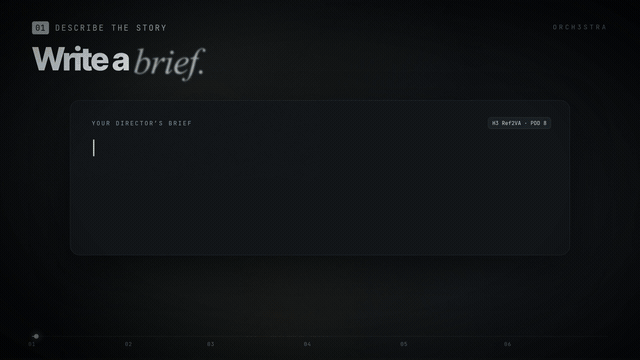

# Orch3stra

Orch3stra is a self-hosted AI filmmaking studio that runs in your browser. You describe a story, pick or build reference images and voices for your cast, and Orch3stra plans the film as short generated windows, renders them through a local, headless [WanGP](https://github.com/deepbeepmeep/Wan2GP) worker on your own GPU, and lets you trim, score and export the result as an MP4. Optional voice tools can transcribe source audio and group anonymous speakers locally (pyannote, or NVIDIA Nemotron-3-Diarization) to build voice references; these run on the CPU, not the GPU. Nothing is sent to a cloud renderer; an AI planner is optional and only used if you configure one.

Orch3stra was previously called Shotweft and H3 Director. That is why settings use `H3_*` names and data lives in `~/.local/share/h3-director`. Released under the [MIT license](LICENSE); third-party materials and separately installed models keep their own terms ([notices](THIRD_PARTY_NOTICES.md)).

## Showcase

[](docs/media/orch3stra-promo.mp4)

**[Watch the 50-second tour with sound (MP4)](docs/media/orch3stra-promo.mp4)**

The footage in the tour is *The Keeper*, a 30-second film made end to end in Orch3stra. A one-paragraph brief was planned into a cast and two scenes with Codex. Four reference pictures were generated with Qwen Image 2.1 (Viggle Turbo, 6 steps). The film was rendered as two 15-second MiniMax H3 Ref2VA windows (pruned 20B, PDD-8, 832×480) on a 16 GB laptop GPU, at about 13 minutes per window, then finished in Post. Its picture and sound both come straight from H3.

## Requirements

| | |
| --- | --- |
| OS | Linux. macOS and Windows are untested. |
| GPU / VRAM | Whatever your chosen model needs in WanGP: Orch3stra adds no GPU requirement of its own, so follow [WanGP's upstream requirements](https://github.com/deepbeepmeep/Wan2GP). Memory use grows with resolution, number of references and window length, so start small (see [Timing](#configuration-basics)). |
| WanGP | An existing, working WanGP install with its own Python environment. Orch3stra does not bundle WanGP, models, or a Python environment, and never downloads models during startup. |
| Python | The WanGP environment's interpreter, Python 3.10 or newer. |
| Node.js | Node 22 or newer. No `npm install` step is needed. |
| FFmpeg | `ffmpeg` and `ffprobe` with H.264/AAC support on `PATH`, or set `FFMPEG_BIN` / `FFPROBE_BIN`. |

## Quick start

```sh
git clone https://github.com/TaylorBeeston/orch3stra.git
cd orch3stra

# 1. Point Orch3stra at your WanGP folder and its Python (e.g. /path/to/Wan2GP/.venv/bin/python).
#    Review the paths and type SAVE. Only these non-secret paths are saved; nothing is installed.
node start-headless.mjs --setup

# 2. Check paths, Python version, FFmpeg/FFprobe and the data folder. No models are loaded.
node start-headless.mjs --check

# 3. Start (or reuse) the WanGP worker and the editor.
node start-headless.mjs
```

Then open <http://127.0.0.1:8765/>.

`--check` exits **1** if a required check failed and **2** if the structural checks passed, but it can't tell whether WanGP will actually load a model. Exit 2 is the normal "good to go" result. [FIRST-RUN.md](FIRST-RUN.md) explains each message.

If you only want to edit, without starting a renderer, run `node bridge.mjs` instead.

## Agent-driven filmmaking

Start with [`.agents/skills/make-film/SKILL.md`](.agents/skills/make-film/SKILL.md). It teaches an agent the actual production workflow: original story and cast, image-first look development, bounded shot calibration, continuity and listening review, take selection, Post, captions, export and backups. The [executable recipe](.agents/skills/make-film/references/recipe.md) authors an original three-shot film plan without inference, then shows the separately authorized production continuation.

With the studio running, use the dependency-free Node 22+ CLI:

```sh
node orch3stra.mjs doctor
node orch3stra.mjs tools
node orch3stra.mjs describe timeline
node orch3stra.mjs call project --json '{"action":"create","name":"My original film","request":"A short original film about an unexpected act of kindness."}'
```

`describe` exposes each tool's JSON schema, effects and examples. `call` accepts inline JSON, `@file`, or `-` for stdin. The same tools are available over MCP with `node orch3stra.mjs mcp`; [connection instructions](.agents/skills/make-film/references/operations.md) generate a host configuration using the actual Node executable and checkout path. MCP also serves the filmmaking skill as resources and a `make_film` prompt.

The interface covers project/story/cast/timeline authoring, references and native media preparation, planner requests, reference automation, rendering and recovery, voice/sound/speech tools, Post and exports. Existing projects must first be published to Studio. Mutations require the latest server revision; browser drafts are separate and pull explicitly. Expensive/external/destructive actions require explicit per-call scopes, and image-model license acknowledgement remains separate. Scopes are agent admission checks, not an OS sandbox or an enforced spending budget. Unknown submission outcomes are never automatically replayed; actual media must be reviewed before calling a film finished.

For isolated real-app verification, see [`.agents/skills/verify-orch3stra/`](.agents/skills/verify-orch3stra/SKILL.md). Local checks include authenticated CLI/MCP authoring and backup downloads; modelled worker tests do not establish live-model output quality.

## Making your first video

1. Open **Settings** (or click **Connect an AI planner →** under the brief). Pick a planner and its model, click **Connect & discover**, choose an **H3 Ref2VA** preset (the pruned 20B PDD-8 preset suits 16–24 GB GPUs), tick the confirmation box and **Save preferences**. Rendering is refused until a preset is confirmed.
2. In the editor, write a short original brief, open **Story → Story + cast**, and review the proposal before applying it.
3. Add reference images (and, optionally, voices) that you own or are licensed to use. For each window, check which cast members appear and are heard.
4. Start with **one short window**. Review its render plan, then submit it. Rendering is always an explicit action and loads your installed model.
5. Watch progress in **Render overview**. When footage is ready, trim and mix it in **Post** and export it.
6. Also make a **portable project backup**. A movie export and a project backup are different things; see [PORTABLE-BACKUPS.md](PORTABLE-BACKUPS.md).

## Where outputs go

- **Finished movies:** in Post, use **Download Post MP4**, or **Save movie & sidecars to Videos** to write the export into `~/Videos`.
- **Browser projects and reference media:** saved in this browser’s IndexedDB, separately for each browser profile and site origin. Unsynced projects/media can exist only there.
- **Published server copies and server settings:** `H3_DATA_DIR`, default `~/.local/share/h3-director`. **Publish / save current project** is opt-in; this directory does not automatically contain all browser projects or their latest edits.
- **Worker renders:** `H3_HEADLESS_DATA_DIR`, default `$H3_DATA_DIR/headless`, which holds `uploads/`, `outputs/`, `previews/` and `continuations/` plus the job database.

Before moving/upgrading, clearing browser storage or changing browser profile/origin, export a **portable project backup for every unsynced project**, including its needed reference media. Portable backups do not embed worker-owned rendered videos: back up those files and the server data directory separately. Treat these folders and exports as private; see [PORTABLE-BACKUPS.md](PORTABLE-BACKUPS.md) and [docs/UPGRADING.md](docs/UPGRADING.md).

## Configuration basics

`node start-headless.mjs --setup` saves the WanGP root and Python path. These environment variables override settings:

| Variable | Default | Purpose |
| --- | --- | --- |
| `H3_WANGP_ROOT` | saved by `--setup` | WanGP folder |
| `H3_PYTHON` / `H3_WANGP_PYTHON` | saved by `--setup` | WanGP Python interpreter |
| `H3_DATA_DIR` | `~/.local/share/h3-director` | Private project data |
| `H3_HEADLESS_DATA_DIR` | `$H3_DATA_DIR/headless` | Worker jobs and renders |
| `H3_HOST` | `127.0.0.1` | Editor bind address |
| `H3_PORT` | `8765` | Editor port |
| `H3_WANGP_PORT` | `7867` | Local worker port |
| `H3_IDLE_RELEASE_SECONDS` | `900` | Free the worker's pinned model RAM after this many idle seconds (`0` keeps it loaded) |
| `H3_HOSTNAMES`, `H3_PUBLIC_ORIGIN` | unset | Extra allowed hosts for a deliberate network setup |

Keep the default loopback bind. `H3_HOST=0.0.0.0` enables LAN access with device pairing, but traffic is unencrypted HTTP.

**Timing.** By default each generated window aims for 15 seconds (24 fps). Windows of up to 30 seconds need an explicit opt-in in Settings. Longer windows use much more RAM and VRAM, and your model's limit still applies. See [TIMING-ADVISOR.md](TIMING-ADVISOR.md).

**AI planner.** Optional. Configure it in Settings, or sign in with a Codex subscription ([docs/USAGE.md](docs/USAGE.md#codex-subscription-sign-in)). Provider calls may cost money.

**Optional voice tools.** Check what's installed with `node scripts/setup-tools.mjs --check`. `--install-tools` installs extra packages into the selected environment, so back that environment up first. Transcription (faster-whisper) and speaker grouping (pyannote or Nemotron) run on the CPU: the voice worker is started with no visible GPU, so they don't compete with renders for VRAM, but long sources take a while. `--nemotron` installs Nemotron's pinned Transformers into a separate overlay that only the speaker-grouping helper uses, so WanGP's own packages are untouched. See [ENVIRONMENT.md](ENVIRONMENT.md) and [DIARIZATION.md](DIARIZATION.md).

**Lifecycle.** `node start-headless.mjs --status` shows the worker. `--stop` stops an idle worker and refuses to stop one that's rendering. Closing the browser tab doesn't stop anything. Ctrl-C stops the editor, but an accepted render keeps going in the worker. After a restart, managed sequences stay paused until you resume them.

## Troubleshooting

| Problem | What to do |
| --- | --- |
| `--check` exits 1 | Read the failing check in its JSON output. Usually the WanGP root or Python path is wrong; rerun `--setup`. |
| Missing `wgp.py` or `shared/api.py` | Select the WanGP root folder itself, not a subfolder. |
| `spawn ... ENOENT` / Python not found | Fix the Python path with `--setup`. |
| FFmpeg/FFprobe unavailable | Install them, or set `FFMPEG_BIN` / `FFPROBE_BIN`. |
| Out of memory / very slow renders | Use a shorter window, fewer references, a lower resolution, or a smaller model. |
| Render overview says the renderer is no longer running | The worker process exited, most often because Linux's out-of-memory killer stopped it while a model was loading (H3 pins about 20 GB of weights in RAM). Check `journalctl -k \| grep -i oom` and the end of `worker.log`, close memory-heavy apps (large `/tmp` tmpfs contents count too), then use **Restart renderer**. The interrupted job is marked failed, never replayed. |
| "Renderer queue is paused" | The worker pauses its queue after restarting with unfinished work so nothing replays unexpectedly. When you start a render you'll be offered **Resume renderer queue**; then start it again. |
| "A different renderer version is running" / different WanGP root | Wait for the current render to finish, run `node start-headless.mjs --stop`, then start again. |
| Second editor refused (writer lock) | Only one editor can use a data directory at a time. Stop the other one. Never delete the lock or ledger blindly; see [docs/INTENT-LOCK-RECOVERY.md](docs/INTENT-LOCK-RECOVERY.md). |
| Unsure whether a render was submitted | Check Render overview and the worker status before you resubmit. Don't blindly repeat it. |

The full table is in [FIRST-RUN.md](FIRST-RUN.md). Logs can contain prompts and filenames, so keep them private.

## Further reading

- [docs/USAGE.md](docs/USAGE.md): usage guide
- [FIRST-RUN.md](FIRST-RUN.md): setup and error messages
- [HEADLESS.md](HEADLESS.md): the headless WanGP worker
- [EDITOR.md](EDITOR.md), [POST.md](POST.md), [SEQUENCES.md](SEQUENCES.md), [REFERENCES.md](REFERENCES.md): feature guides
- [ENVIRONMENT.md](ENVIRONMENT.md), [DIARIZATION.md](DIARIZATION.md): optional speech tools
- [docs/UPGRADING.md](docs/UPGRADING.md), [PORTABLE-BACKUPS.md](PORTABLE-BACKUPS.md): upgrades and backups
- [WANGP-COMPATIBILITY.md](WANGP-COMPATIBILITY.md): supported WanGP versions
- [CHANGELOG.md](CHANGELOG.md), [SECURITY.md](SECURITY.md), [CONTRIBUTING.md](CONTRIBUTING.md)

## Contributing

Run the CPU-only checks with `node scripts/check-all.mjs` (CI runs `python scripts/check-ci.py`; see [docs/CI.md](docs/CI.md)). They use synthetic fixtures and never run models. See [CONTRIBUTING.md](CONTRIBUTING.md).

Use one Git checkout for both development and running the app, and update it with `git pull` while the worker is idle. Your projects live in `H3_DATA_DIR`, not in the checkout.
